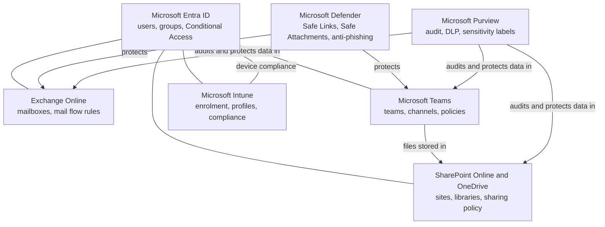
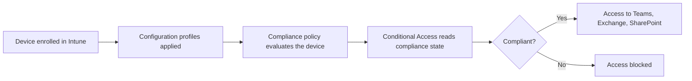

# Microsoft 365 Administration Lab: CloudLab Enterprises

A hands-on Microsoft 365 administration project built in a free Microsoft 365 E5 developer tenant. I set up a fictional company, CloudLab Enterprises, and administered it as its new IT administrator: users and licences, Exchange Online, SharePoint and OneDrive, Teams, Intune, Conditional Access, Defender and Purview.

## Contents

- Overview
- Objectives
- Technologies Used
- Skills Demonstrated
- Environment
- Lab Architecture
- Project Scope
- Repository Structure
- Implementation Summary
- Configuration Reference
- Validation and Testing
- Troubleshooting
- Security Considerations
- Lessons Learned
- Future Improvements
- Author

## Overview

Microsoft 365 appears in almost every IT support, help desk, system administrator and cloud support job description. I wanted to manage it myself rather than only read about it, so I joined the Microsoft 365 Developer Program, which provides a free E5 tenant for learning and testing. It uses the same admin portals as a production tenant, so this is not a simulator.

To give each task a business reason, I created CloudLab Enterprises, a professional services company with five departments and twelve users, and worked as though I had just been hired to run its IT. For each setting I recorded what I changed and why.


Microsoft 365 admin center home page for the `cloudlabent` tenant with the admin account signed in.


## Objectives

- Build a realistic tenant with departments, users, licences and administrative roles.
- Administer Exchange Online: mailboxes, shared mailbox, distribution groups, mail flow rules and email protection.
- Structure SharePoint and OneDrive with least-privilege permissions and restricted external sharing.
- Govern Teams creation and configure messaging and meeting policies.
- Manage Windows devices with Intune and tie compliance to Conditional Access.
- Use Purview and Defender for auditing, data loss prevention, sensitivity labels and threat protection.
- Document the decisions, tests and the mistakes made along the way.

## Technologies Used

| Area | Technology |
| --- | --- |
| Tenant | Microsoft 365 Developer Program, E5 developer tenant (Instant Sandbox) |
| Administration | Microsoft 365 admin center |
| Email | Exchange Online, Exchange admin center |
| Collaboration | SharePoint Online, OneDrive for Business, Microsoft Teams, Teams admin center |
| Identity and access | Microsoft Entra ID, Conditional Access |
| Endpoint management | Microsoft Intune, Windows Autopilot |
| Threat protection | Microsoft Defender for Office 365 (Safe Attachments, Safe Links, anti-phishing, anti-spam) |
| Compliance | Microsoft Purview (Audit, DLP, sensitivity labels), Microsoft Secure Score |

## Skills Demonstrated

| Skill | Where it appears |
| --- | --- |
| Tenant setup, custom domain and DNS records | Tenant setup |
| Licensing, mailbox and shared mailbox administration | Exchange Online |
| Mail flow rules and email security policies | Exchange Online |
| Site, library and permission design, sharing policy | SharePoint and OneDrive |
| Teams governance, messaging and meeting policy | Microsoft Teams |
| Enrolment, configuration profiles, compliance, app deployment, remote actions | Intune |
| Conditional Access with report-only mode and break-glass accounts | Intune, Troubleshooting |
| Audit search, DLP, sensitivity labels, Secure Score, Defender | Security and compliance |
| Troubleshooting from evidence | Troubleshooting |

## Environment

| Item | Detail |
| --- | --- |
| Program | Microsoft 365 Developer Program (free), Instant Sandbox |
| Licences | Microsoft 365 E5, 25 available, 12 assigned |
| Tenant domain | `cloudlabent.onmicrosoft.com` |
| Custom domain | Added and verified, status Healthy (name not recorded in this repository) |
| Company | CloudLab Enterprises, professional services |
| Departments | IT, Finance, Human Resources, Sales, Management |
| Users | 12 |
| Administrative roles | Global Administrator, IT Administrator, Exchange Administrator |

This is a developer sandbox, not a production tenant. No real company or customer data is involved.

## Lab Architecture



The access path for devices:



## Project Scope

**In scope**

- Developer tenant creation, custom domain verification, company structure
- Exchange Online, SharePoint Online, OneDrive, Teams
- Intune for Windows devices, with Conditional Access
- Purview audit, DLP and sensitivity labels; Defender email protection; Secure Score hardening
- Testing each configuration with test accounts and recording four problems and fixes

**Not covered in the documentation**

- iOS, Android or macOS device management
- Hybrid or on-premises Active Directory
- Retention policies and eDiscovery
- Scripted or PowerShell-based administration
- Large-scale or production-sized deployments

## Repository Structure

```
.
├── README.md
├── LICENSE
├── .gitignore
├── docs/
│   ├── 01-tenant-setup.md
│   ├── 02-exchange-online.md
│   ├── 03-sharepoint-onedrive.md
│   ├── 04-microsoft-teams.md
│   ├── 05-intune-endpoint-management.md
│   ├── 06-security-and-compliance.md
│   ├── 07-troubleshooting.md
│   ├── design-decisions.md
│   └── lessons-learned.md
└── screenshots/
    └── README.md                   Index of expected screenshots
```

## Implementation Summary

| Step | Guide | Outcome |
| --- | --- | --- |
| 1 | Tenant setup | E5 developer tenant, custom domain, CloudLab Enterprises structure |
| 2 | Exchange Online | Mailboxes, shared mailbox, four distribution groups, two mail flow rules, anti-spam and anti-phishing policies |
| 3 | SharePoint and OneDrive | Four private department sites, libraries, restricted permissions, internal-only sharing |
| 4 | Microsoft Teams | Creation restricted to a security group, six teams, messaging and meeting policies |
| 5 | Intune | Autopilot profile, two configuration profiles, compliance policy, Conditional Access, app deployment |
| 6 | Security and compliance | Audit search, DLP, Secure Score 47% to about 74%, Defender policies, sensitivity label |
| 7 | Troubleshooting | Four problems with causes, fixes and lessons |

The reasoning behind the main choices is collected in Design decisions.

## Configuration Reference

| Area | Setting |
| --- | --- |
| Shared mailbox | `support@cloudlabent.onmicrosoft.com`, display name CloudLab Support, three IT users with Full Access and Send As |
| Distribution groups | `all-staff`, `finance-team`, `it-team`, `management` (all-staff restricted to management senders) |
| Mail flow rules | External email disclaimer; reject `.exe`, `.bat`, `.ps1`, `.vbs` attachments |
| SharePoint sites | `CloudLab-IT`, `CloudLab-Finance`, `CloudLab-HR`, `CloudLab-Sales`, all Private |
| External sharing | Restricted to people inside the organisation |
| Teams creation | Only members of the `Teams-Creators` security group (IT and Management) |
| Meeting policy | Anonymous join disabled, transcription on, recording for organisers and co-organisers |
| Intune profiles | Baseline Security Settings, Browser Settings (both assigned to All Devices) |
| Compliance | BitLocker, Secure Boot, Defender, firewall, antivirus, Windows 10 22H2 or later, 12-character password, 3-day grace period |
| Conditional Access | Require Compliant Device for Microsoft 365 Access, all users, report-only first |
| DLP | UK Financial Data template, warn internally, block externally, simulation before enforcement |
| Sensitivity label | CloudLab Confidential Finance, encrypted, Finance users only |

## Validation and Testing

| Area | Test | Result |
| --- | --- | --- |
| Shared mailbox | Delegated user sent a test message from Outlook | Appeared as sent from CloudLab Support |
| Mail flow | External email to a personal Gmail account | Disclaimer appended |
| Distribution groups | Message sent to each group | Every member received it |
| Co-authoring | Same document opened by two Finance users | Edits and cursors visible in near real time, versions recorded |
| Teams announcements | Finance user tried to reply in Company Wide | Could read, could not post |
| Teams meeting | Guest account joined a Finance meeting | Placed in the lobby |
| Teams files | Document uploaded in the IT team | Found in the team’s SharePoint site |
| Intune | Sync action triggered on an enrolled device | Device checked in and applied policies |
| Conditional Access | Report-only before enforcement | Enforcement later locked out an admin account (see Troubleshooting) |
| DLP | Email with a fake card number sent to Gmail | Blocked |
| Sensitivity label | Opened a labelled file with a non-Finance account | Access denied |
| Secure Score | Recommendations applied | About 47% to about 74% |

Details are in each guide. Several tests are recorded in the source notes without a result (for example the attachment-blocking rule), and those are listed as configured rather than tested.

## Troubleshooting

1. **Conditional Access locked out my Global Administrator account.** An un-enrolled laptop counted as non-compliant. Recovered after about thirty minutes, then created two break-glass accounts excluded from policy.
2. **DLP kept flagging test emails.** The policy was behaving as designed and recording incidents. Investigated in Purview and used a temporary exception during testing.
3. **Intune policies showed Not Applicable.** The device had been enrolled as personal. Re-enrolled as corporate with the work account.
4. **SharePoint permissions did not behave as expected.** A new subfolder did not have the access I intended. Broke inheritance on the subfolder and re-tested with another user.

See Troubleshooting.

## Security Considerations

- **Least privilege:** private department sites, restricted libraries, standard users on Autopilot-provisioned devices.
- **Safe rollout:** Conditional Access and DLP were both introduced through a non-enforcing mode first.
- **Emergency access:** two break-glass accounts, excluded from Conditional Access, with long complex passwords stored securely.
- **Data protection:** internal-only sharing, DLP, and a sensitivity label that encrypts content wherever it travels.
- **Layered email defence:** mail flow rules, anti-spam, anti-phishing, Safe Attachments and Safe Links.
- **Repository hygiene:** no credentials, tenant IDs or real domains in this repository; see `screenshots/README.md`.

## Lessons Learned

- Security controls can lock out administrators as easily as attackers, so create break-glass accounts first.
- Teams and SharePoint are linked: many file problems in Teams are SharePoint permission problems.
- Configuration is not enough. Test with different user accounts.
- Use report-only and simulation modes before enforcing.
- A correct policy may still not apply if the environment does not meet its conditions, such as device ownership.

More in Lessons learned.

## Future Improvements

- Add iOS and Android device management and an app protection policy.
- Test the attachment-blocking rule, Safe Links and anti-phishing impersonation protection with recorded results.
- Add retention policies and an eDiscovery exercise.
- Automate user creation and licensing with PowerShell or Microsoft Graph.
- Add guest access and external collaboration scenarios.

